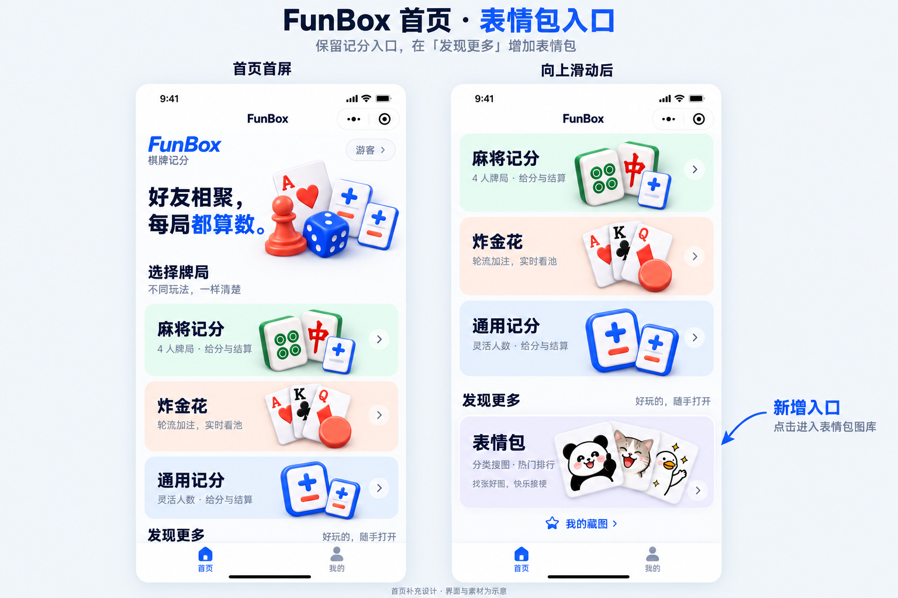
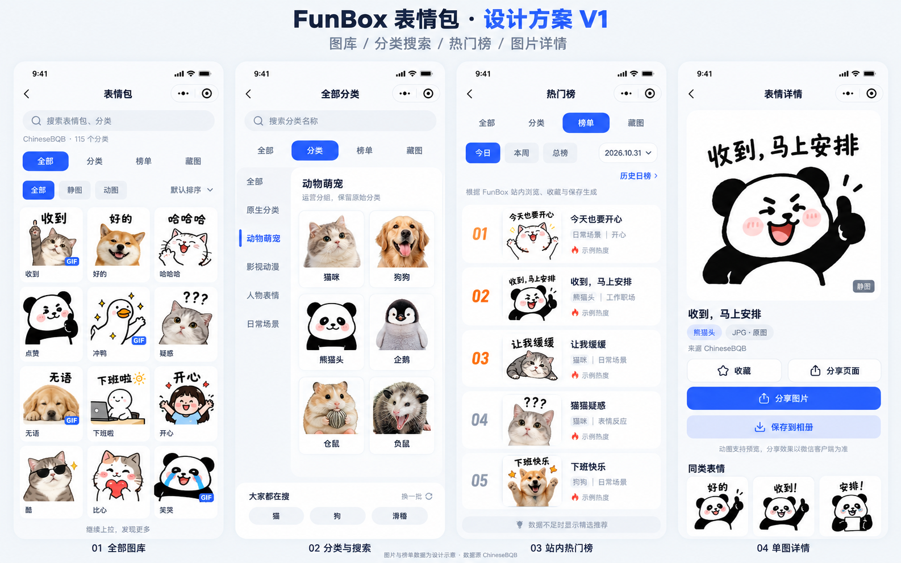

# FunBox 表情包设计图 V1

- [接入调研与完整方案](../superpowers/specs/2026-10-31-meme-design.md)
- [四屏设计图](./meme-design-board.png)
- [首页入口补充设计](./meme-home-entry.png)
- [已实施功能、运行配置与验证](./implementation.md)

## 首页入口补充

左右分别是同一个首页的首屏和下滑状态。保留现有品牌、主视觉及三个记分卡片；在“通用记分”下面新增“发现更多”区块，以浅紫色独立卡片承载“表情包”，副标题“分类搜图 · 热门排行”。整张卡片点击进入全部图库，返回时回到原首页滚动位置；全局底部继续使用“首页 / 我的”。

沿用当前首页卡片尺寸时，新入口在多数普通手机上需要上滑才能完整看见。设计图明确展示这一点；不把所有内容压缩到首屏，也不把新入口混入“选择牌局”。用户批准实施时明确要求首页不加“我的藏图”，因此忽略图中该快捷链接，收藏仅保留在表情包模块内。

这是一张根据当前首页代码和现有插画绘制的视觉方案，不是已运行的小程序截图。

## 表情包内部页面

从左到右：全部图库、分类与搜索入口、站内热门榜、单图详情。

设计图为 AI 生成的视觉初稿，图片、语义标题、运营分组和热度均为示意，不是上游实际返回内容或已经开发的界面。分类搜索页底部“大家都在搜”是未来有真实搜索统计后的状态；首发应改为“试试这些分类”，避免暗示尚不存在的用户热搜数据。榜单画的是已有有效站内数据的状态，冷启动应显示无排名的“精选推荐”。

颜色与结构延续当前小程序：主色 `#2d5bff`、背景 `#f5f7fa`、白色圆角卡片；模块内导航与全局“首页 / 我的”分开。详情分享/保存按钮按图片格式和客户端能力显示，以真机验证为准。

方案已获用户批准并进入实施，详见实施计划与实施记录。
